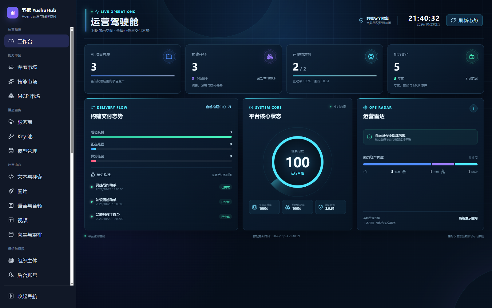
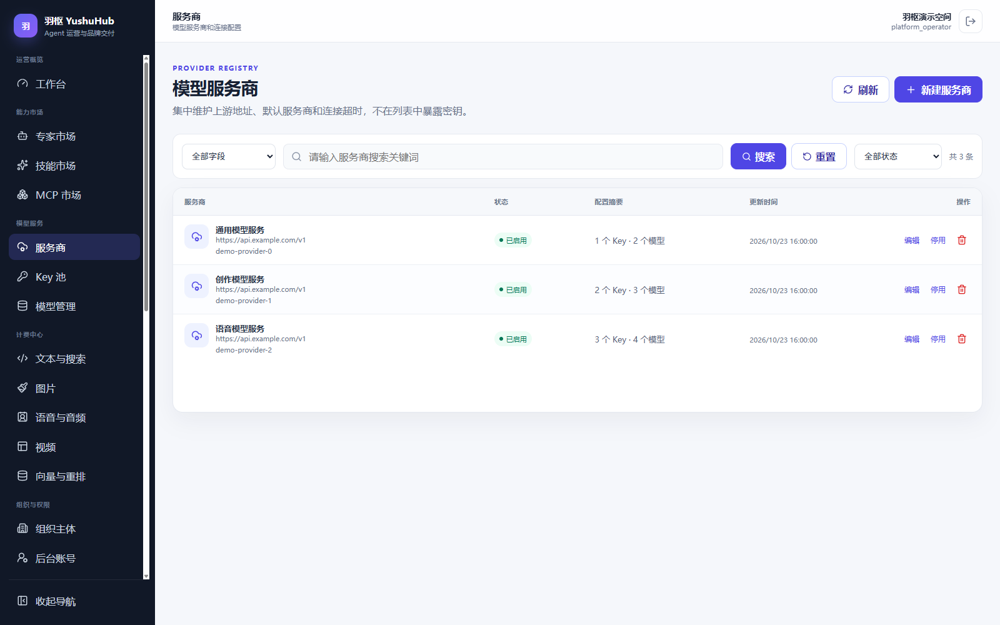
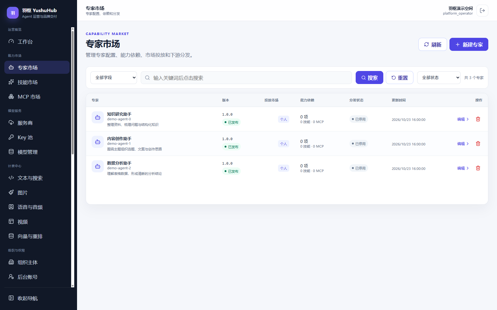
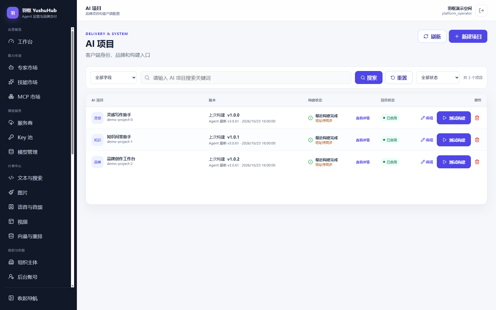

# 羽枢 · YushuHub

**面向 Agent 应用的运营管理与品牌交付平台。**

将模型服务、账号权益、积分计费、能力分发和品牌项目集中管理，让开发者专注于 Agent 本身的体验与能力。

羽枢提供可独立部署的 Web 管理后台与 HTTP API，可作为自有 AI 产品、Agent 应用或 OEM 贴牌业务的后台基础。现有 Agent Desktop 是其中一个已集成的客户端；其他 Web 应用、桌面应用和 Agent 服务可以在适配接口后接入。

项目早期技术名称为 **Agent AI Admin**；包名和部署标识保持兼容。**本仓库是管理端的主研发仓库，后续功能、修复和版本在此持续维护。**羽枢采用源码可用许可，学习、非商业评估与内部自用可免费使用；已获有效 Agent Desktop 商业、代理或 OEM 授权的主体，在原授权范围内配套部署和使用管理端，无需另付管理端软件许可费。其他对外商业运营及 OEM 交付需另行授权。

## 界面预览

以下为真实管理界面截图，使用虚构演示数据，不含真实客户账号、密钥或运营数据。显示的品牌可由部署方配置。

### 运营工作台

集中查看项目、交付任务、执行节点和能力资产。



<details>
<summary>模型服务、专家市场与品牌项目（点击展开）</summary>

### 模型服务

维护服务商与连接配置，关联 Key 池和模型目录。



### 专家市场

维护智能体配置、依赖和分发状态，由接入方运行时执行。



### 品牌项目

管理独立项目的品牌与客户端配置。现有构建交付适配 Agent Desktop，其他产品需实现对应适配。



</details>

## 为什么选择它

- **从模型接入到业务运营**：在同一后台管理服务商、Key 池、模型目录、报价、用户、会员与消费记录。
- **面向多品牌交付**：按项目管理品牌素材、登录页和客户端策略，配合自定义官网与渠道体系开展品牌运营。
- **支持渠道协作**：组织主体、后台成员、角色权限和数据范围分开管理，支持上下级代理与分发授权。
- **能力可以持续分发**：集中维护智能体配置、Skills 和 MCP 资源，管理版本、发布状态与授权范围。
- **管理与执行分工清晰**：平台管理服务、资源与运营策略，Agent 在接入方自己的运行时中执行。
- **源码可继续扩展**：Vue 3 + TypeScript 管理界面，Node.js + Express 后端，按领域组织路由和服务。

## 核心能力

| 领域 | 已有能力 |
| --- | --- |
| 模型服务 | 服务商配置、模型目录、Key 池、连通性检查；Key 可在服务商下通用或限定单个模型 |
| 定价与计量 | 文本与搜索、图片、语音等已有接入的计费规则，积分扣费、调用明细与用量报表 |
| 用户运营 | 终端用户、邮箱注册与找回密码、会员卡、兑换码、积分流水、支付配置与订单 |
| 组织权限 | 上下级代理组织、后台账号、岗位与角色模板、功能权限及数据范围 |
| 能力市场 | 精选智能体配置、Skills、MCP 的内容维护、版本管理与分发 |
| 品牌项目 | 名称与标识、登录页方案、关于与联系信息、外部链接及项目配置 |
| 客户端策略 | 项目级注册开关、个人模型开关、可选的来源项目账号范围限制；需客户端实现对应协议 |
| 消息触达 | 通知、公告、活动消息、接收范围与阅读状态，支持中心到代理同步 |
| 官网与运维 | 自定义静态官网、上传资源、存储配置、诊断与管理端自更新 |
| 构建交付 | 构建任务、Worker 状态、产物存储、版本与发布记录；当前交付链路已对接 Agent Desktop |

模型供应商、支付和邮件等外部服务需要自行配置。视频、向量与重排等菜单中的开发中能力，以实际实现为准。

## 适用场景

### Agent 产品的运营后台

为已有 Agent 客户端或服务补齐账号、模型、会员、积分、资源分发和运营报表，减少重复建设业务后台的工作。

### 多品牌与 OEM 贴牌项目

统一维护多个品牌项目，管理各自的视觉素材、客户端策略和交付记录；结合代理组织、权限及分发授权开展渠道业务。

### 自有 AI 应用的管理基础

为 Web 应用、桌面工具或垂直领域 AI 产品提供管理界面与业务 API，在现有领域模块上扩展自己的产品逻辑。

## 接入其他产品

后台独立运行，接入方通过 HTTP API 使用账号、模型、计费与资源服务。建议按产品需求分步接入：

1. 对接客户端身份认证、用户与项目标识。
2. 对接模型目录、模型调用、权益检查与计费结果。
3. 按需接入资源市场、通知和远程策略。
4. 需要品牌包交付时，再适配品牌配置、Worker、产物格式和更新协议。

现有客户端接口位于 [`src/routes/client-api.mjs`](src/routes/client-api.mjs)，其他业务接口按领域组织在 [`src/routes/`](src/routes/)；整体结构见 [架构说明](docs/ARCHITECTURE.md)。这些是现有实现入口，并非承诺兼容所有第三方客户端的统一 SDK。

**当前 AI 项目构建与更新流程包含 Agent Desktop 的品牌、版本和产物合同。** 接入其他贴牌产品时，需要替换或扩展相应适配；部署本管理端不会自动获得桌面端源码、安装包或中央构建服务授权。智能体市场负责配置与资源分发，具体执行仍由接入方的 Agent 运行时负责。

## 本地运行

需要 Node.js 20 或以上版本，以及可访问的 MySQL 数据库。前端开发工具的 Node.js 要求以 `web-admin` 依赖声明为准。

```bash
git clone https://github.com/mengyuxuezhang/YushuHub.git
cd YushuHub
npm ci
```

复制 [`.env.example`](.env.example) 为 `.env`，配置数据库连接和初始管理员账号。先创建专用数据库与数据库账号；应用启动时会初始化表结构并执行兼容迁移。

最小本地配置示例：

```dotenv
AI_ADMIN_HOST=127.0.0.1
AI_ADMIN_PORT=7077
AI_ADMIN_USER=admin
AI_ADMIN_PASSWORD=change-me-before-run

AI_DB_HOST=127.0.0.1
AI_DB_PORT=3306
AI_DB_USER=agent_ai
AI_DB_PASSWORD=change-me-before-run
AI_DB_NAME=agent_ai

AI_ADMIN_PUBLIC_URL=http://127.0.0.1:7077
```

```bash
npm run check
npm start
```

打开 `http://127.0.0.1:7077/admin`。仓库包含已构建的管理界面；只有修改前端源码时才需要重新构建。

生产部署与安装向导见 [部署指南](docs/DEPLOYMENT.md)。公网部署使用 HTTPS；数据库、`.env`、密钥和运行数据应保存在受控目录，升级前做好备份。外部服务、存储和构建中心按实际使用的功能配置。

## 开发与扩展

```bash
# 后端检查与基础回归
npm run check

# 安装管理界面依赖
npm run admin:install

# 前端开发、检查与构建
npm run admin:dev
npm run admin:typecheck
npm run admin:test
npm run admin:build
```

```text
cloud/ai-admin/   服务启动与依赖组装
src/routes/      HTTP 路由与输入校验
src/services/    业务服务
src/repositories/ 数据访问
src/db/          数据库连接与结构
web-admin/       Vue 3 管理界面源码
web/admin-v2/    管理界面构建产物
web/site/        默认公开首页
scripts/         检查、安装与打包工具
docs/            架构、部署与领域文档
```

新增接入优先扩展对应领域的路由、服务与前端模块，保持已有 API、权限和数据隔离行为兼容。提交问题时请附版本、复现步骤和脱敏日志，勿附账号密码、Token 或客户数据。

参与开发请阅读 [贡献指南](CONTRIBUTING.md)、[开发约定](AGENTS.md)和 [文档索引](docs/README.md)，从最新 `origin/master` 创建分支。发布步骤见 [版本发布](docs/RELEASING.md)。

## 代码范围与许可

本仓库维护管理端代码；**Agent Desktop 桌面端源码不在本仓库的公开及授权范围内**。接入某个客户端、模型供应商或构建服务，不会改变其独立的授权与使用条件。

本项目采用 [羽枢源码可用许可证 1.0](LICENSE)，限制部分商业用途，**不属于 OSI 认可的标准开源许可**。个人学习、非商业评估及符合定义的公司内部自用可免费使用。已获有效桌面端商业、代理或 OEM 授权的主体，可在原授权的品牌、项目、客户及交付范围内配套使用本管理端，包括运营收费桌面端项目，无需重复购买管理端软件许可；普通终端用户许可不等于代理/OEM授权。其余收费 Agent/AI 产品后台、OEM/白标交付、转售与商业托管等用途需另行授权。具体条款以 LICENSE 为准，第三方依赖、品牌标识和素材遵循各自许可。

作者与版权署名：**李杰（梦羽学长）**。商业授权及合作联系 **[204429778@qq.com](mailto:204429778@qq.com)**，详见 [商业授权说明](COMMERCIAL_LICENSE.md)。
